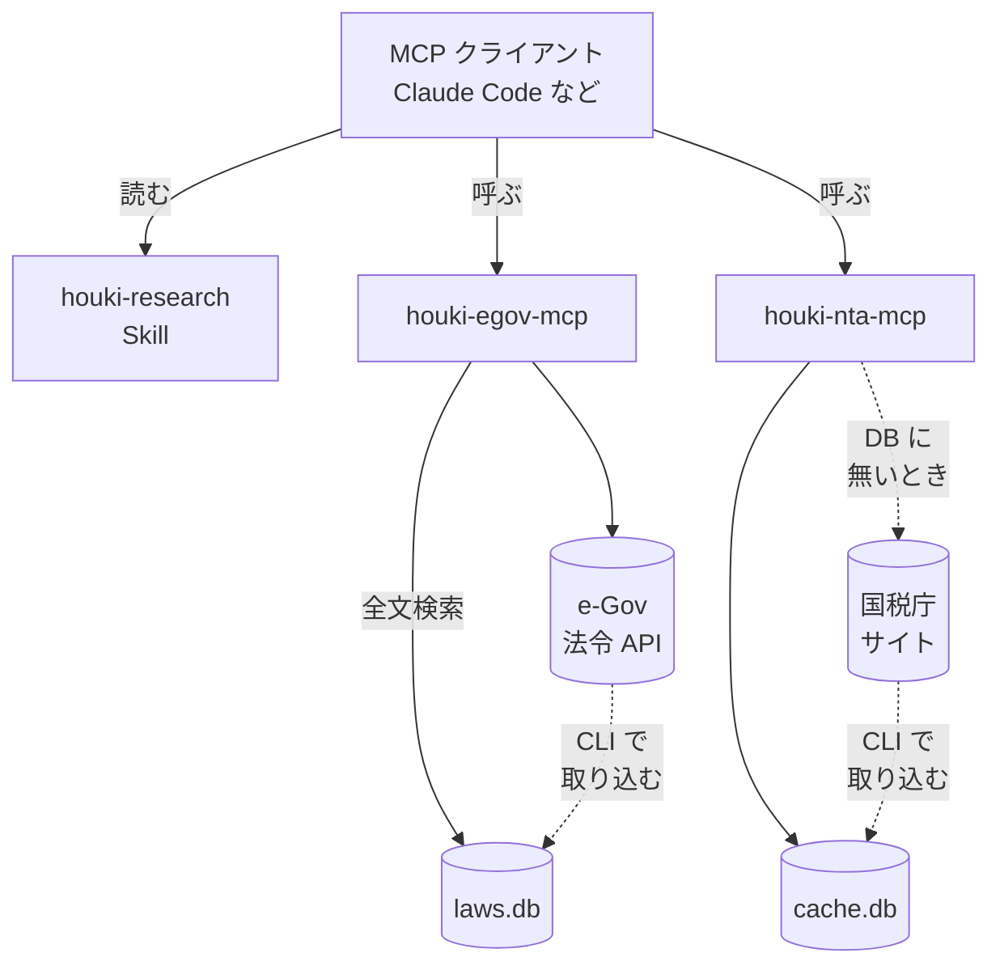

# houki-hub とは

houki-hub は、**日本の法令・通達・行政解釈を LLM から引く**ための部品を束ねたものです。
「法律で決まっている」と「通達でそうなっている」を混ぜずに、出典と鮮度を添えて返します。

返すのは、関わる条文と通達の本文、拘束力の別、何が事実認定に依存するかという論点までです。これを使うのは、仕様が法令のどこに触れるかを調べる設計者・実装者、自分の案件を調べる本人、そして**自分の業務の調査に使う弁護士・税理士・社会保険労務士**です。資格者が調査の道具として使うことは、通常の使い方です。

返さないのは、個別の事案に条文を当てはめた結論・可否・金額です。当てはめと結論は、事実を見た人（資格者本人か、相談を受けた資格者）が出すものなので、ツールはその手前で止まります（[しないこと](#しないこと)）。

部品は 3 種類あり、それぞれ独立したリポジトリとして公開しています。**MCP サーバー**は LLM が呼び出せるツールの集まり（MCP はそのための規格の名前）、**共有ライブラリ**は MCP サーバーの中で使う辞書と関数、**Skill** は LLM が読む手順書です。4 つの部品をまとめて **family（法規シリーズ）** と呼びます。ほかの語（鮮度・`legal_status`・正典 など）は [用語](/guide/glossary) にまとめています。

| 種類 | 部品 | 役割 |
| --- | --- | --- |
| MCP サーバー | houki-egov-mcp / houki-nta-mcp | 一次資料（法令・通達）を取りに行き、構造化して返します |
| 共有ライブラリ | houki-abbreviations | 略称の解決、全角ゆらぎの正規化（「ＮＩＳＡ」と「NISA」のような表記の違いを揃えること）、鮮度の判定を全 MCP に提供します |
| Skill | houki-research | MCP をどの順に呼び、出典をどう書き、どこで注意喚起するかを LLM に指示します |

部品と、部品が本文を取りに行く先のつながりは次のとおりです。

ローカル DB はどちらも任意です。2 つの DB の役割の違いは [ローカル DB（全文検索用）](/guide/local-database) にあります。

## 解決したいこと

LLM に法令のことを尋ねると、条番号や通達番号をもっともらしく作ってしまうことがあります。
houki-hub の MCP サーバーは、e-Gov 法令 API と国税庁サイトという一次資料から本文を取得し、
法令番号・条・項・号、通達番号、取得元 URL を応答に含めます。
LLM はその応答を引用して答えるので、「どこに書いてあるか」を利用者が自分で確かめられます。

もう一つは「古い情報を新しいものとして扱ってしまう」ことです。
応答には取得日時と鮮度の判定（`freshness`。取得した内容がどれだけ新しいかの印）を付け、Skill は古い場合に再取得を指示します。

## いま扱える範囲と、まだ扱えない範囲

法律・政令・省令は e-Gov 法令 API に載っているものすべてを対象にしており、分野を問いません。
一方、通達・Q&A などの行政解釈は **現時点では国税庁のものだけ** です。
最初に税務から着手したためで、厚生労働省をはじめ他省庁の通達は、同じ型の MCP サーバー（houki-mhlw-mcp など）を 1 つずつ足して広げていく予定です。

::: info 通達は国税庁のものだけです
「通達を引ける」と書いてある箇所は、当面は「国税庁の通達を引ける」と読んでください。
:::

文書の種類（法律・政令・省令・規則・条例・告示・通達・裁決・判例など）ごとに、誰を拘束するかと担当する MCP サーバーを [文書の種類と拘束力](/guide/document-types) にまとめています。条例・告示・最高裁判所規則と、国税庁・厚生労働省以外の通達は、担当する MCP サーバーがありません。

各部品の版と、次に足す予定の MCP サーバーは [現状と予定](/guide/roadmap) にまとめています。

利用者の立場（一般の人・士業者・設計者や実装者）ごとに何ができて何ができないかは、[利用者ごとにできることとできないこと](/guide/scope-by-audience) にまとめています。

## 想定する利用者

入口として想定しているのは、システムの開発・運用・管理を行うエンジニアです。たとえば次のような場面です。

- 新しい機能の実現可能性を調べるとき、法令上の制約（電子帳簿保存法の要件、個人情報保護法の第三者提供の条件など）を条文で確かめる
- 会計・人事のアプリケーションで、参照している通達が改正されていないか、国税庁の索引に今もあるかを確認する
- 「この略称は正式には何という法令か」「この条文の改正履歴は」を、その場で引く

同じ部品を、次の 2 種類の利用者も使います。

- **MCP を組み込む開発者**: 問いを投げるのではなく、`tools/list` の `inputSchema`・エラーコード・`next_actions` の契約を読んで自分のエージェントに組み込みます。契約は houki-research Skill の `docs/` に[正典](/guide/glossary#仕様とその置き場所)（決める文書はここ 1 つ、という置き場所）があります
- **自分の申告・届出のために条文と国税庁の解釈を自分で引く人**: 本人が自分の事務として調べる範囲です。「私の場合はどうなるか」に転じたところで、Skill は条文・通達・論点までを返し、結論は返しません（下の「しないこと」）

利用者ごとに別の部品があるわけではありません。MCP は誰が呼んでも同じ条文を返し、問いの形に応じた手順の違いは houki-research Skill の workflow が持ちます。

## しないこと

::: warning 個別の事案への当てはめ
houki-hub は **個別の事案に法令を当てはめて結論を出すこと** を目的にしていません。
想定しないのは次の 2 つです。この MCP が個別の事案の結論を返すこと、そして資格のない者がその出力を他人の事件や税務の判断として業で渡すことです。後者は弁護士法 72 条・税理士法 52 条・社労士法 27 条が資格者に限定しています。
資格者本人が自分の業務の調査に使うことは、この禁止の中身ではありません。
houki-research Skill は、質問が個別の事案の結論に入りそうなときに注意を促し、資格者への相談を案内する文言を返します。
:::

どこまでを返し、どこからを返さないかを、1 つの例で示します。

| 問い | 返すか | 返すもの |
| --- | --- | --- |
| 「領収書を PDF で保存する機能を作る。電子帳簿保存法の要件は」 | 返します | 電子帳簿保存法 7 条と施行規則 4 条の本文、タイムスタンプ・検索要件の条文、国税庁の一問一答のうち該当する項目。それぞれに出典と取得日時 |
| 「うちの経理では PDF を共有フォルダーに置いて、ファイル名に日付を入れている。これで要件を満たしているか」 | 返しません | 関わる条文と、「満たすかどうかは検索機能の有無と訂正削除の記録の仕方で変わる」という論点までを返し、「満たしている / いない」は返しません。資格を持つ専門家への相談を案内します |

2 つ目の問いは、具体的な事実（共有フォルダー、ファイル名の付け方）を法令の要件に照らして結論を出すことで、これを「当てはめ」と呼びます。houki-hub は条文と論点を揃えるところまでを引き受け、当てはめと結論は資格を持つ専門家に委ねます。

また、開発者が LLM をホストして「答えるサービス」を提供する構造は作りません。
部品を提供し、それを組み込む側が責任主体になる形を保ちます。

## 名前について

「houki」は「法規」です。family の MCP サーバーは `@shuji-bonji/houki-{束ねる単位}-mcp` という名前で、
束ねる単位は組織（egov / nta / mhlw）かコンテンツ種（saiketsu / court / metadata）のどちらかです。
名前は広めに取り、初版で実装する範囲は各リポジトリの README に明示しています。

## 関連するプロジェクト

houki-hub のリポジトリ構成と設計方針は、同じ作者の [PDF Agent Stack](https://shuji-bonji.github.io/pdf-agent-stack/) と揃えています。
houki-nta-mcp は国税庁の PDF の本文を読まず、PDF ごとの読み方と保存したファイルのパスを返します。表として取るときは PDF Agent Stack の pdf-reader-mcp と組み合わせますが、手元の別の PDF 読み取りツールでも読めます。
